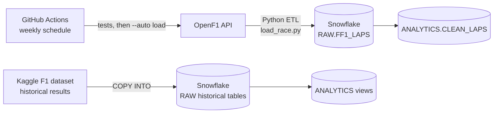

# F1 Pit Strategy Analysis

An automated data pipeline and analytics project on Formula 1 race strategy. Lap-by-lap timing, tire, and pit-stop data is ingested after every race weekend into a Snowflake warehouse, cleaned into an analysis-ready layer, and used to study how tires degrade and when teams should pit.

**Status:** Phase 1 (data pipeline) complete · Phase 2 (tire degradation model) in progress · Phase 3 (natural-language strategy assistant) planned

## Architecture



## What it does

- **Ingests** every Grand Prix from 2023 onward from the [OpenF1 API](https://openf1.org): lap and sector times, tire compound and age, stints, pit stops, and drivers. About 97,000 laps so far.
- **Transforms** five API endpoints into one table with a row per driver per lap, deriving tire life, pit-in and pit-out laps, and pit-lane time.
- **Validates** every race before loading (duplicate laps, impossible lap times, implausible race length, missing tire data). A race that fails a check never reaches the warehouse.
- **Loads incrementally**: each run loads only finished races that aren't already in Snowflake, so reruns are safe.
- **Runs itself**: a GitHub Actions workflow runs the test suite every Monday, then loads any new races.
- **Cleans for analysis**: the `CLEAN_LAPS` view removes laps that would distort tire analysis (see below).

## Tech stack

Python (pandas, requests) · Snowflake (SQL, `snowflake-connector-python`) · pytest · GitHub Actions

## Repository layout

```
sql/
  01_setup_warehouse.sql      warehouse, database, schemas
  02_create_raw_tables.sql    Kaggle historical tables
  03_load_data.sql            loads the Kaggle CSVs
  04_analytics_schema.sql     analytics layer on the historical data
  05_clean_laps.sql           analysis-ready lap data from the pipeline
pipeline/
  load_race.py                extract → transform → validate → load
  tests/test_load_race.py     unit tests (no network or database needed)
  requirements.txt
.github/workflows/
  load_races.yml              weekly scheduled run
```

## Running it

```bash
cd pipeline
python -m venv .venv && source .venv/bin/activate
pip install -r requirements.txt -r requirements-dev.txt
cp .env.example .env          # add your Snowflake account, user, and access token

pytest                        # run the tests
python load_race.py 2026 1    # load one race
python load_race.py --auto    # load every finished race not yet loaded
```

The scheduled workflow reads the same three credentials from GitHub repository secrets.

## Design decisions

**Switching data sources.** The pipeline was first built on the FastF1 library, which reads from Formula 1's live-timing server. Testing showed that server now rejects requests from many networks (HTTP 401 from a home network, and it's reported to block cloud hosts like GitHub Actions). I moved extraction to OpenF1, a free API that works from any network, which also made scheduled runs possible.

**Idempotent, incremental loads.** Each race is identified by season and round. A run checks what's already loaded and skips it, so a failed or repeated run never creates duplicate rows. `--replace` reloads a race deliberately.

**Handling API quirks.** OpenF1 returns `404 Not Found` instead of an empty list when a query has no results (for example, races with no recorded pit stops). The pipeline treats that as "no rows" and still derives pit laps from the lap data. A unit test covers the case.

**Cleaning without a safety-car flag.** OpenF1's lap data doesn't say which laps ran under a safety car. Instead, `CLEAN_LAPS` excludes any lap more than 7% slower than that race's median lap. Safety car laps typically run 30–40% slower, so the cutoff removes them along with incident laps while keeping normal laps on worn tires. It also excludes lap 1, pit-lane laps, and wet-weather tires. About 82–84% of laps are kept in every season.

**Comparing circuits.** Lap times range from about 75 seconds (Monaco) to over 100 (Spa), so `CLEAN_LAPS` includes `PACE_RATIO`: each lap's time divided by its race's median. That puts every circuit on the same scale.

**Cost control.** The Snowflake warehouse is X-Small, suspends after 60 seconds idle, and is capped by a monthly resource monitor. Programmatic access tokens authenticate the pipeline, and credentials live in `.env` locally and in GitHub Secrets for scheduled runs.

## Roadmap

- **Phase 2: Tire degradation model.** Predict lap-time loss from tire age and compound by circuit, evaluated on races the model hasn't seen, and use it to estimate optimal pit windows.
- **Phase 3: Strategy assistant.** Ask questions in plain English ("How long did Norris's hards last at Monza?"). An LLM writes read-only SQL, runs it, and explains the answer, with guardrails and a measured accuracy score.
- **Dashboard.** A Streamlit app with self-updating strategy charts.

## Data sources

- [OpenF1](https://openf1.org): 2023 season onward
- [Formula 1 World Championship dataset (Kaggle)](https://www.kaggle.com/datasets/rohanrao/formula-1-world-championship-1950-2020): historical results back to 1950
