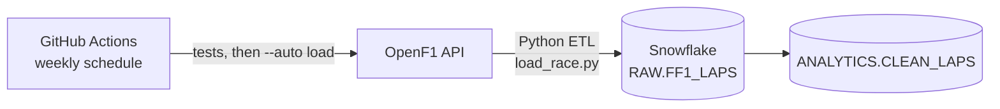

# F1 Pit Strategy Analysis

A portfolio project applying SQL, data engineering, and statistical analysis to Formula 1 race strategy. It has two parts:

1. **Historical analysis (2011–2025):** a Snowflake warehouse built from the Kaggle F1 dataset, used to test three questions about pit stops and the undercut, published as a Tableau dashboard.
2. **Live pipeline (2023–present):** an automated Python pipeline that loads lap-by-lap timing, tire, and pit data after every race weekend, as the foundation for a tire degradation model and strategy tools.

**[→ View the live Tableau dashboard](https://public.tableau.com/app/profile/brian.earle1210/viz/F1PitStrategyAnalysis2011-2025/F1PitStrategyAnalysis2011-2025)**

**Status:** Historical analysis complete · Live pipeline complete · Tire degradation model in progress · Strategy assistant and interactive dashboard planned

---

## Part 1: Historical analysis

### Questions

1. Is Ferrari's pit crew actually as slow as the public narrative suggests?
2. Which circuits favor the "undercut" pit strategy most, and least?
3. Is undercut success actually explained by track length, or is that just a convenient story?

Each finding is backed by SQL queries against the full dataset and, for the third, a statistical significance test rather than a visual guess.

### Findings

#### 1. [Ferrari's Pit Stop Speed vs. the Field](findings/01_ferrari_pit_stops.md)
Contrary to the public narrative, Ferrari ranks near the top of the field for pit stop speed since 2020, averaging ~24.3s, just behind Red Bull's ~24.1s and well ahead of the slowest teams (Haas, Sauber, ~25.7–26s).

#### 2. [Undercut Success Rate by Circuit](findings/02_undercut_by_circuit.md)
Undercut success varies enormously by track, from ~9.9% to ~39.6% across circuits with a sufficient sample size (n≥100 attempts). Tracks like the Korean International Circuit, Shanghai, and Suzuka favor the undercut most; Mexico City favors it least.

#### 3. [Does Track Length Explain Undercut Success?](findings/03_lap_length_correlation.md)
Testing lap length as a measurable driver of undercut success, rather than relying on subjective "overtaking difficulty": a Pearson correlation of **r = 0.42** (p = 0.022, significant at the 95% level) shows a real but moderate relationship. Track length explains roughly 17% of the variance in undercut success (r² ≈ 0.17), so it's a contributing factor, not the whole story.

### Dashboard

The [Tableau Public dashboard](https://public.tableau.com/app/profile/brian.earle1210/viz/F1PitStrategyAnalysis2011-2025/F1PitStrategyAnalysis2011-2025) visualizes all three findings:
- Ferrari pit stop speed vs. the field (2020–2025), highlighted against the average
- Undercut success rate by circuit, color-graded by success rate
- Lap length vs. undercut success, with trend line and correlation coefficient

### Data and warehouse

Source: [Formula 1 World Championship dataset](https://www.kaggle.com/datasets/rohanrao/formula-1-world-championship-1950-2020) on Kaggle (Ergast API archive). Pit stop and lap-by-lap timing data only exists from the **2011 season onward**, so all pit stop and undercut analysis is scoped to 2011–2025.

Snowflake warehouse with two schemas:

- **RAW:** 14 tables loaded directly from the Kaggle CSVs via internal stage and `COPY INTO` (drivers, constructors, circuits, races, results, pit stops, lap times, standings, etc.)
- **ANALYTICS:** derived tables built with `CREATE TABLE AS SELECT`, joining and enriching the raw tables:
  - `PIT_STOPS_ENRICHED`: pit stops with driver, race, and constructor context
  - `RACE_RESULTS_ENRICHED`: race results with driver, constructor, and status context
  - `CIRCUIT_LENGTHS`: manually sourced reference table of lap length (km) per circuit

The `data/` folder contains the CSV extracts used to build the Tableau dashboard.

---

## Part 2: Live pipeline



### What it does

- **Ingests** every Grand Prix from 2023 onward from the [OpenF1 API](https://openf1.org): lap and sector times, tire compound and age, stints, pit stops, and drivers. About 97,000 laps so far.
- **Transforms** five API endpoints into one table with a row per driver per lap, deriving tire life, pit-in and pit-out laps, and pit-lane time.
- **Validates** every race before loading (duplicate laps, impossible lap times, implausible race length, missing tire data). A race that fails a check never reaches the warehouse.
- **Loads incrementally:** each run loads only finished races that aren't already in Snowflake, so reruns are safe.
- **Runs itself:** a GitHub Actions workflow runs the test suite every Monday, then loads any new races.
- **Cleans for analysis:** the `CLEAN_LAPS` view removes laps that would distort tire analysis (see below).

### Running it

```bash
cd pipeline
python -m venv .venv && source .venv/bin/activate
pip install -r requirements.txt -r requirements-dev.txt
cp .env.example .env          # add your Snowflake account, user, and access token

pytest                        # run the tests
python load_race.py 2026 1    # load one race
python load_race.py --auto    # load every finished race not yet loaded
```

The scheduled workflow reads the same three credentials from GitHub repository secrets.

### Design decisions

**Switching data sources.** The pipeline was first built on the FastF1 library, which reads from Formula 1's live-timing server. Testing showed that server now rejects requests from many networks (HTTP 401 from a home network, and it's reported to block cloud hosts like GitHub Actions). I moved extraction to OpenF1, a free API that works from any network, which also made scheduled runs possible.

**Idempotent, incremental loads.** Each race is identified by season and round. A run checks what's already loaded and skips it, so a failed or repeated run never creates duplicate rows. `--replace` reloads a race deliberately.

**Handling API quirks.** OpenF1 returns `404 Not Found` instead of an empty list when a query has no results (for example, races with no recorded pit stops). The pipeline treats that as "no rows" and still derives pit laps from the lap data. A unit test covers the case.

**Cleaning without a safety-car flag.** OpenF1's lap data doesn't say which laps ran under a safety car. Instead, `CLEAN_LAPS` excludes any lap more than 7% slower than that race's median lap. Safety car laps typically run 30–40% slower, so the cutoff removes them along with incident laps while keeping normal laps on worn tires. It also excludes lap 1, pit-lane laps, and wet-weather tires. About 82–84% of laps are kept in every season.

**Comparing circuits.** Lap times range from about 75 seconds (Monaco) to over 100 (Spa), so `CLEAN_LAPS` includes `PACE_RATIO`: each lap's time divided by its race's median. That puts every circuit on the same scale.

**Cost control.** The Snowflake warehouse is X-Small, suspends after 60 seconds idle, and is capped by a monthly resource monitor. Programmatic access tokens authenticate the pipeline, and credentials live in `.env` locally and in GitHub Secrets for scheduled runs.

---

## Repository layout

```
sql/
  01_setup_warehouse.sql          warehouse, database, schema, stage setup
  02_create_raw_tables.sql        RAW schema table definitions (Kaggle)
  03_load_data.sql                COPY INTO statements loading all 14 raw tables
  04_analytics_schema.sql         ANALYTICS schema: enriched tables
  05_clean_laps.sql               analysis-ready lap data from the live pipeline
  ferrari_queries.sql             Finding 1 queries
  undercut_overcut_analysis.sql   Findings 2 & 3 queries
findings/                         write-ups for the three historical findings
data/                             CSV extracts behind the Tableau dashboard
pipeline/
  load_race.py                    extract → transform → validate → load
  tests/test_load_race.py         unit tests (no network or database needed)
.github/workflows/
  load_races.yml                  weekly scheduled run
```

## Tools used

- **Snowflake:** data warehousing, SQL transformation
- **SQL:** joins, CTEs, window functions, aggregate functions, correlation analysis (`CORR()`)
- **Python:** pandas and requests for the ETL pipeline; scipy for significance testing
- **pytest** and **GitHub Actions:** automated testing and scheduled runs
- **Tableau Public:** dashboard and data visualization
- **Git/GitHub:** version control

## Roadmap

- **Tire degradation model:** predict lap-time loss from tire age and compound, with team-specific rates, correcting for fuel burn and evaluated on races the model hasn't seen.
- **Strategy simulator:** compare one- and two-stop strategies for each team at upcoming races.
- **Interactive dashboard:** a Streamlit app with animated Plotly charts that update after every race.
- **Strategy assistant:** ask questions in plain English, answered from the data with an LLM, with guardrails and a measured accuracy score.
